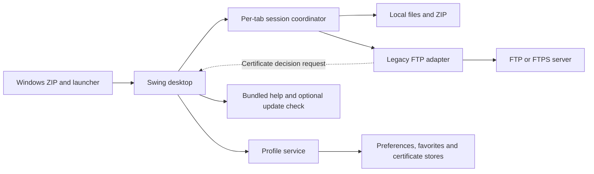
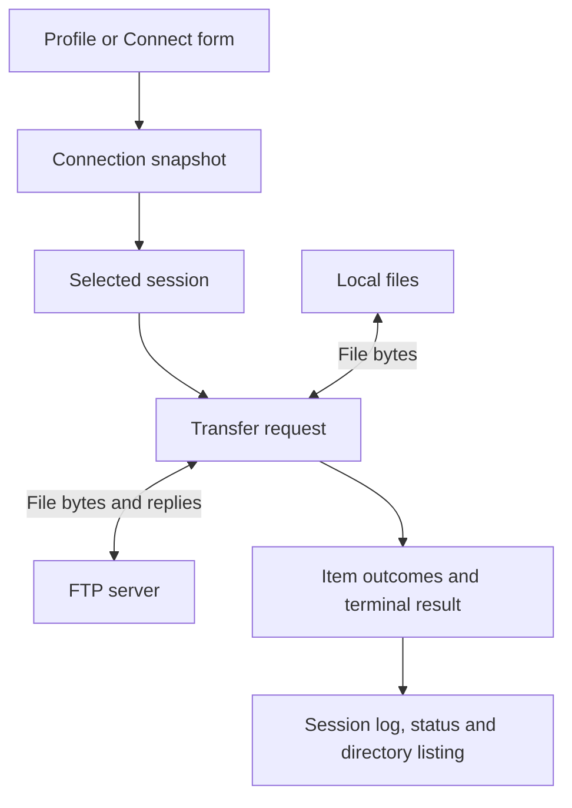
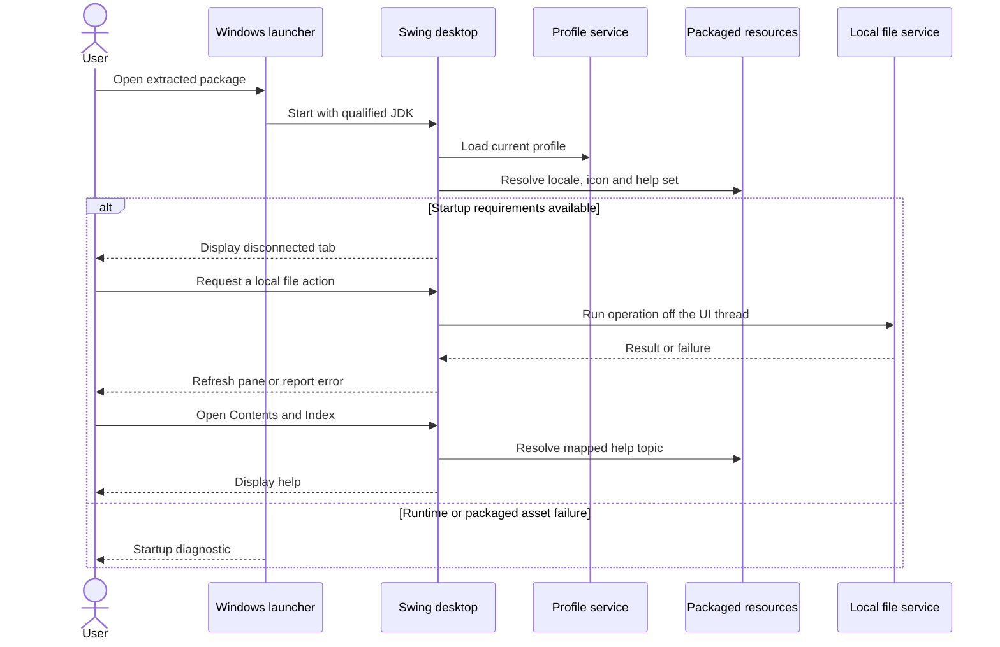

# ADR — JFTP desktop modernization baseline

**Date:** 2026-11-19  
**Status:** Accepted for scope, platform, and delivery sequence. The component contracts below describe the target for the first modernization stage.  
**PRD:** [JFTP Desktop](../PRD.md)  
**Source baseline:** `a15ac14`

## 1. Overview

First recover a runnable JFTP baseline and characterize behavior on Windows. Then move the desktop build to JDK 25 and a pinned stable Maven release, isolate FTP integration, and add a recoverable route for existing profiles. The PRD defines the user-facing baseline. A compatibility change requires a recorded finding and an explicit decision.

1. Reproduce a baseline in Windows using a clean workspace and synthetic profiles. Record the actual runtime, resolved artifact coordinates and checksums, launcher, artifact layout, and behavior observed. If a dependency or compiler blocker prevents a legacy build, record it and make the minimum build-only repair needed to run the baseline. Recheck the PRD observations against that build.
2. Add characterization coverage before changing connection logic, session state, transfer behavior, or storage. Keep fixes needed for reproducibility separate from behavior refactors.
3. Qualify the JDK 25 package on Windows. Introduce the [FTP boundary](001-session-and-ftp-boundary.md) and [profile migration](002-profile-storage-and-migration.md) in independently verifiable increments. Keep the existing desktop workflow available at each increment.

## 2. Technology Documentation References

Context7 was unavailable in the current environment. These official references are the starting point for implementation.

| Technology | Official documentation | Used for |
| --- | --- | --- |
| JDK 25 and Swing | [Java desktop module](https://docs.oracle.com/en/java/javase/25/docs/api/java.desktop/module-summary.html) · [Oracle JDK downloads](https://www.oracle.com/java/technologies/downloads/#java25) | Runtime and desktop APIs. Swing ships with the JDK. |
| Desktop automation | [JDK 25 AWT Robot](https://docs.oracle.com/en/java/javase/25/docs/api/java.desktop/java/awt/Robot.html) | Native input on an interactive Windows desktop. |
| Apache Maven | [Stable releases](https://maven.apache.org/download.cgi) · [Maven Wrapper](https://maven.apache.org/tools/wrapper/) · [Java release targeting](https://maven.apache.org/guides/mini/guide-java-target.html) · [Assembly descriptor](https://maven.apache.org/plugins/maven-assembly-plugin/assembly.html) | Pin the build and define the distribution layout. |
| JUnit | [JUnit 6.1.3 guide](https://docs.junit.org/6.1.3/overview.html) | Unit and integration harness. |

## 3. System Architecture

The application remains a single desktop process and Maven project. The current source combines Swing windows, session workers, file operations, protocol calls, and profile storage in one artifact. The target introduces internal boundaries in that artifact. Server traffic stays on the client-to-server connection. There is no application backend or shared database.

| Layer | First-stage target |
| --- | --- |
| Runtime and UI | JDK 25 and the Swing APIs in its `java.desktop` module. Start qualification on Windows x64 with Oracle JDK **25.0.5.1**, the published Windows x64 build verified on this ADR's date. Pin the exact distribution and checksum after the Windows probe. |
| Build | Maven **3.10.1**, the current stable release verified on this ADR's date. Pin it in Maven Wrapper. Pin compatible plugin versions after the initial build probe and record them before release. Compile with release target 25. |
| Delivery | A Windows ZIP with a root launcher, the application JAR, adjacent `lib/`, and the current classpath assets. Run through the launcher with a qualified installed JDK 25. The launcher resolves files relative to its own location. |
| Session and I/O | One session coordinator and FTP connection per tab. Swing owns UI state. Session workers perform blocking operations. Local files, ZIP operations, and the FTP adapter are separate boundaries. |
| User data | Local profiles, with a compatibility reader and recoverable migration. See [storage ADR](002-profile-storage-and-migration.md). |
| Tests | JUnit 6.1.3, controlled local FTP/FTPS endpoints, and automated native Swing UI flows on Windows. |

At the source baseline the POM targeted Java 5. The [recovered baseline](../testing.md) compiled for Java 8 on the Windows probe JDK and excluded the unused Apple-specific adapter. The POM declares the FTP and help libraries and packages localization, icons, and JavaHelp resources. The JavaHelp menu initializes during window construction. These assets are part of the packaged startup contract. The assembly puts the app JAR at the package root and dependencies under `lib/`. The Windows launcher resolves the root JAR from its own directory. Verify that layout with the actual ZIP for each packaging change. [POM](../../pom.xml) · [Assembly](../../src/main/assembly/binary.xml) · [Windows launcher](../../src/main/scripts/jftp.bat) · [Runtime resource index](../jftp-runtime-resources.md)

## 4. Module Structure and Dependencies

| Component | Owns | Depends on |
| --- | --- | --- |
| Desktop bootstrap | Startup ordering, resource availability, main window, and session creation | UI, profile services |
| Swing UI | Dialogs, pane selection, action availability, status and user decisions | Session coordinator and profile service contracts |
| Session coordinator | One tab's connection, operation lifecycle, selected directories and filters | FTP port, local file and archive operations, immutable settings snapshot |
| FTP adapter | Translation between JFTP requests and the legacy client, including protocol events | Legacy FTP dependency and narrow certificate decision callback |
| Local file and archive services | Local browsing, file actions, ZIP and temporary edit files | File system and current session request |
| Profile services | Preferences, favorites, certificate-store paths and migration | Profile files and certificate stores |
| Help and update integration | Packaged help topics and optional update check | Bundled resources and legacy update endpoint |

The UI calls service contracts. Adapters publish results and events through those contracts. Dependency types do not pass through to UI models. Where the current code crosses these boundaries, move one behavior at a time after its characterization coverage exists. The focused ADRs specify the connection and storage contracts.

## 5. Data Models

| Model | Key fields | Lifetime |
| --- | --- | --- |
| Session | Stable tab identity, local and remote directories, connection state, filters, active operation | Created with a tab and disposed on close. Reconnection uses the session's prior site settings. |
| Connection settings | Host, ports, username, optional account, credential, security and transfer modes, initial paths, ordered startup commands | Snapshot for one connection attempt. Saved favorites persist through the profile service. |
| Transfer request and result | Session identity, direction, selected entries, destination, mode, item outcomes, overall completion or abort | Request runs within its session. Completion updates only that session. |
| Profile | Preferences, favorites, server and client certificate-store references | Local to the Windows user and carried forward by the compatibility reader and migration. |
| Desktop resource reference | Locale and message key, icon name, help topic | Resolved from packaged assets during startup or user interaction. |

## 6. Interface Contracts

| Boundary | Input | Output and failure |
| --- | --- | --- |
| Windows launcher → desktop | Extracted distribution and qualified Java executable. Ambient working directory may differ from the archive root. | Opens a window with one disconnected tab and usable local pane. Missing runtime or layout reports a startup failure. |
| UI → session coordinator | Validated action, session identity, selected entries and options | Asynchronous status and terminal result for that session. Progress and completion are applied on the event dispatch thread. After close, stale completions cannot update a replacement tab. |
| Session coordinator → FTP | Connection snapshot and typed operation requests | See [FTP boundary](001-session-and-ftp-boundary.md) for result and cancellation rules. |
| UI → profile service | Load, save, or migrate a named local profile | Typed profile, success, or actionable failure. See [storage ADR](002-profile-storage-and-migration.md). |
| UI → help and update integration | Help topic or configured update action | Resolve the packaged topic. The optional update service can report availability or failure without controlling whether the window opens. Live endpoint behavior is unverified. |

## 7. Environment Variables

| Variable | Purpose | Required | Example |
| --- | --- | --- | --- |
| `JAVA_HOME` | Select the qualified JDK for the wrapper and packaged Windows launcher | Required in the build and verification environment. The packaged launcher may use the qualified `java.exe` on `PATH` when unset. | `C:\Java\jdk-25` |
| `PATH` | Locate Java when no home is supplied | Required for that launcher fallback | Directory containing the qualified `java.exe` |

Profile verification uses an isolated Windows user or a temporary user home selected via the `user.home` system property. Test endpoint addresses are harness inputs. Application credentials are profile or session data.

## 8. Technical Decisions

### Recover behavior before changing it

**Status:** Accepted  
**Date:** 2026-11-19  
**Context:** At the source baseline, the repository had no runnable automated test suite and the shipped launcher layout was uncertain.\
**Decision:** Build a runnable baseline and add characterization tests before refactoring. Keep the single Swing application and JavaHelp startup contract.  
**Rejected alternatives:** A rewrite would change too many observations at once. Replacing both the transport and packaging immediately would make failures hard to attribute.  
**Consequences:** Requires an initial recovery and evidence step. Later changes can be evaluated against the same profiles, scripts, and endpoints.  
**Review trigger:** The legacy runtime or exact dependencies cannot be obtained reproducibly after the dependency probe.

### Qualify a Windows ZIP on the JDK 25 line

**Status:** Accepted  
**Date:** 2026-11-19  
**Context:** Windows is the first-stage platform and the existing source and launcher predate the target toolchain.  
**Decision:** Keep one distribution layout, pin the stable toolchain, and test the extracted ZIP outside the source tree. Refresh the JDK 25 patch only with the same qualification gates.  
**Rejected alternatives:** A multi-platform release expands the first-stage verification matrix. Maven preview releases add an avoidable build variable.  
**Consequences:** Windows support is measurable. Installer and bundled runtime choices can be revisited separately.  
**Review trigger:** A requirement to support another OS, a self-contained installer, or a different JDK feature line.

### Separate session effects from display and storage

**Status:** Accepted  
**Date:** 2026-11-19  
**Context:** The current session combines Swing actions, protocol operations, and asynchronous completion. Saved profiles and trust stores have their own lifecycle.  
**Decision:** Keep per-tab operation state and move protocol and profile access behind separate contracts. Keep the legacy FTP library for the first stage. Describe current password and certificate exception behavior in the storage ADR.  
**Rejected alternatives:** A full rewrite of the profile store or immediate FTP library replacement would prevent comparison against the recovered baseline.  
**Consequences:** Adapters and fixtures add an initial cost. Later library changes can be measured against explicit contracts.  
**Review trigger:** The legacy client fails a mandatory connection mode with default JDK 25 security settings.

## 9. Diagrams

### 9.1 Architecture

### 9.2 Data flow

### 9.3 Packaged startup, local file actions and help

Connection, remote operations, transfer and abort sequences are in [001](001-session-and-ftp-boundary.md). Favorites, preferences, and migration are in [002](002-profile-storage-and-migration.md).

## 10. Testing Strategy

Write characterization tests against the recovered baseline before replacing behavior. For repairs and new boundaries, write the failing reproduction first. Record unexpected baseline behavior and the corresponding decision before changing an expectation.

| Layer | Scope | Harness |
| --- | --- | --- |
| Unit | Form validation, state transitions, filters, path and profile transformations | JUnit, isolated temporary directories and controlled test doubles |
| Integration | Actual legacy client talking to local FTP/FTPS endpoints, ZIP handling, profile persistence | JUnit, controlled server and generated test data |
| Packaged smoke | Extracted Windows ZIP, actual launcher from a different working directory, resources, clean profile | Interactive Windows runner with the qualified JDK 25 |
| Automated desktop UI | New and switched tabs, validation, connect, upload, download, abort, favorite reuse, help, and certificate decline | AWT Robot or equivalent in a real interactive Windows session. Locate windows and controls by stable names, wait for observable state with a timeout, and keep the loopback server real. |

| Scenario | Expected result | Edge coverage |
| --- | --- | --- |
| Start from the extracted package | One disconnected session, working local pane, and embedded help topic | Extraction path with spaces, launch from another directory, missing Java, clean profile |
| Two simultaneous sessions | Switching tabs preserves each location, selection context, and status destination | Close one tab while its worker is pending |
| Connect and transfer from UI | Invalid input is rejected, valid connection displays the listing, upload and download produce the expected files | Certificate rejection, server error, and abort |
| Reuse a migrated profile | Existing saved site appears and can be selected on reopening | Empty or unreadable profile, failure path defined in ADR 002 |

### Technical acceptance criteria

- **TAC-000-01** A clean Windows build records its JDK distribution and patch, Maven version, plugin versions, and resolved FTP dependency checksum.
- **TAC-000-02** The extracted ZIP starts via its Windows launcher from a different working directory on the qualified JDK 25 and displays a disconnected session and working help topic.
- **TAC-000-03** The automated desktop scenarios execute on an interactive Windows desktop against a loopback server and fail on an unmet assertion. Report screenshots and session logs on failure without credentials.
- **TAC-000-04** A result from a closed session cannot update another tab, and ongoing work in one tab does not prevent interaction with the other tab in the two-session scenario.
- **TAC-000-05** The release evidence includes the successful protocol and profile gates from ADRs 001 and 002, or a recorded incompatibility that blocks release until resolved.
