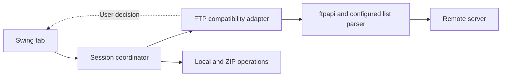
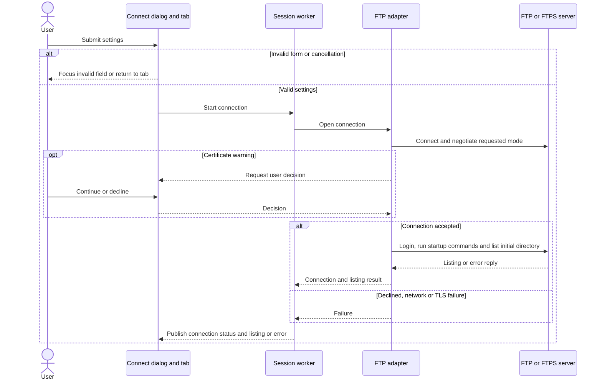
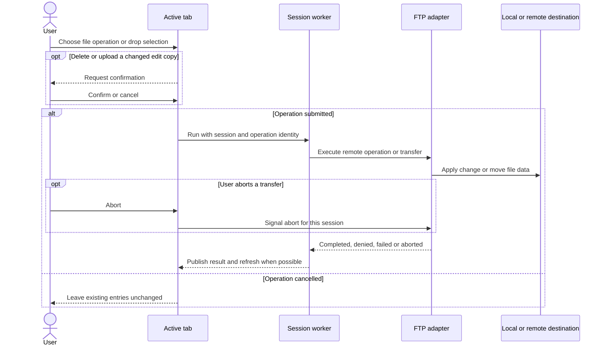

# ADR-001 — Session execution and FTP boundary

**Date:** 2026-11-19  
**Status:** Accepted for first-stage compatibility and isolation  
**Relates to:** [Main architecture](000-main-architecture.md) · [PRD](../PRD.md)

## 1. Scope

Preserve the PRD's per-tab connect, reconnect, directory browsing, remote file actions, transfers, abort, and edit confirmation while isolating the legacy FTP client. Establish which protocol modes actually work on JDK 25 using local fixtures. A dependency replacement or a change in certificate or credential policy requires a separate decision.

## 2. Technology Documentation References

| Technology | Official documentation | Used for |
| --- | --- | --- |
| JDK 25 Swing | [Java desktop module](https://docs.oracle.com/en/java/javase/25/docs/api/java.desktop/module-summary.html) | Event dispatch and worker separation. |
| JDK 25 transport | [JSSE reference guide](https://docs.oracle.com/en/java/javase/25/security/java-secure-socket-extension-jsse-reference-guide.html) | TLS defaults, trust, and diagnostic baseline. |
| Apache MINA FtpServer | [TLS configuration](https://mina.apache.org/ftpserver-project/configuration_ssltls_support.html) · [Embedded server](https://mina.apache.org/ftpserver-project/embedding_ftpserver.html) | Proposed loopback fixture for plain FTP and explicit and implicit FTPS. Pin a compatible test dependency after the Windows probe. |
| Legacy FTP client | [Dependency declaration](../../pom.xml#L71) | `com.myjavaworld:ftpapi:3.0.0`. Published API documentation and the artifact's JDK 25 compatibility remain unverified. Resolve the exact artifact and inspect signatures before implementation. |

## 3. Component Design

The current Connect action fills a site from preferences, and the session loads the configured FTP client and listing parser by class name. The session calls connect and login, executes startup commands, optionally changes the remote working directory, and then loads the listing. The existing custom worker publishes completion on the Swing event dispatch thread. The target keeps the protocol and configured parser choices behind one adapter and keeps blocking network and archive work off the event dispatch thread. [Connect action](../../src/main/java/com/myjavaworld/jftp/actions/ConnectAction.java#L51) · [Session connection](../../src/main/java/com/myjavaworld/jftp/FTPSession.java#L593) · [Legacy worker](../../src/main/java/com/myjavaworld/gui/SwingWorker.java#L128)

One coordinator owns the remote client, remote working directory, active operation, and pending cancellation for one tab. Ordinary remote operations run serially within that session. Abort may signal that session's in-flight operation while it is blocked. Results carry the originating session and operation identities. Closed sessions discard pending UI updates. Separate sessions may run concurrently. Existing SOCKS configuration is process-wide and stays an application preference for the first stage. Capture that behavior explicitly before modifying the startup or preferences routes. [Abort action](../../src/main/java/com/myjavaworld/jftp/actions/AbortAction.java#L50) · [Proxy configuration](../../src/main/java/com/myjavaworld/jftp/JFTPUtil.java#L71)

## 4. Data Structures

| Model | Fields and invariants |
| --- | --- |
| Connection snapshot | Host, normal and implicit ports, user, credential, account, security mode, data-channel choice, direct or passive mode, initial paths, startup commands, and selected client and parser identifiers. Values remain fixed throughout one attempt. |
| Directory snapshot | Session identity, side, current path, and entries with name, kind, known size and timestamps or permission metadata. Missing server metadata is represented explicitly. |
| Session operation | Session and operation identity, typed action, source/destination, filter and transfer mode, and optional abort request. |
| Operation result | Completed, failed, or aborted. Transfers carry observed per-item outcomes where available. Logs and display errors exclude credential values. |

## 5. Interface Contracts

| Boundary | Input | Success and failure |
| --- | --- | --- |
| Connect / reconnect | Validated snapshot. Reconnect takes the tab's last selected site. | Returns connection state and first listing where available. Host or login failure, declined certificate, and listing failure remain distinguishable. A listing error is not treated as a successful listing. |
| Browse / remote mutation | Connected session, working directory and filtered listing request, or selected item and action | Returns listing or operation outcome. Server denial and dropped connection are reported without changing another tab. Includes remote properties, create, rename, delete, permission change and manual FTP commands. |
| Transfer | Connected session, direction, selection, target, optional alternate name or ZIP mode | Reports progress and terminal state, then refreshes the relevant listing where possible. Binary fixture bytes must match on success. A failure or abort may leave partial files and does not imply rollback. |
| Abort / close | Originating session identity and operation when present | Requests protocol abort and stops scheduling subsequent items. Close releases the connection and invalidates pending display events. |
| Certificate decision | Presented chain, host and observed failure reasons | Displays the existing decision prompt and returns continue or reject to the waiting background operation. Details and policy evidence are in [002](002-profile-storage-and-migration.md). |

## 6. Technical Decisions

### Wrap the legacy client before considering replacement

**Status:** Accepted  
**Date:** 2026-11-19  
**Context:** Client and parser selection, server commands, and legacy TLS behavior are coupled to the current library. Compatibility with JDK 25 is an open build and integration question.  
**Decision:** Resolve and checksum the exact dependency. Characterize it against local fixtures before introducing the adapter. Preserve plain FTP, opportunistic SSL, explicit FTPS, and implicit FTPS as the existing compatibility targets, plus active/passive selection. Record the observed handshake and failure behavior of each case. Treat an unavailable required mode as a release decision.  
**Rejected alternatives:** Replacing the client first would conflate library behavior with JDK and build changes. Treating only one FTPS mode as representative would leave the others unverified.  
**Consequences:** The adapter takes on translation and lifecycle complexity. Protocol failures are easier to localize.  
**Review trigger:** The original artifact cannot be obtained from an approved source, or a required mode is incompatible with the qualified JDK 25 defaults.

## 7. Diagrams

### Components

### Connect and list

### Remote actions, transfer, and abort

## 8. Testing Strategy

| Scenario | Type | Input | Expected output and edge cases |
| --- | --- | --- | --- |
| Connection matrix | Integration | Local plain, opportunistic, explicit and implicit endpoints, valid and bad credentials | Record observed negotiation, listing, and failures with default runtime settings. Verify both active and passive paths against controlled fixtures. |
| Certificate prompt | UI and integration | Trusted and generated untrusted certificate, deliberate decline | Trusted case reaches listing. Decline returns a failure. Record current continue behavior with a synthetic chain. |
| Transfer and remote actions | Integration and UI | Binary file, nested tree, alternate name, ZIP, denied write, changed remote edit copy | Compare binary payloads, directory entries and errors. Check a cancelled deletion and declined edit upload. |
| Abort and two tabs | UI and integration | Slow local server and a separate authenticated session | Abort stops remaining work in the first session. Switching tabs or closing the first tab does not change the other session's state. |
| SOCKS | Integration | Controlled proxy, proxy authentication and refusal | Record connectivity and failure results. Keep separate process runs for conflicting proxy settings. |

### Technical acceptance criteria

The Windows probe records the [legacy transport qualification](../transport-qualification.md) as each scenario is verified.

- **TAC-001-01** Verified connection inputs, results, and progress events reaching UI code contain only JFTP-owned types.
- **TAC-001-02** A dated Windows compatibility matrix records each mode, the fixture and certificate setup, actual outcome and default-JDK failure reason where applicable.
- **TAC-001-03** Successful binary upload and download match the fixture's SHA-256, and a successful directory refresh reflects the transferred items.
- **TAC-001-04** Abort during a multi-item transfer prevents the next unstarted item and produces a terminal result associated with the requesting session.
- **TAC-001-05** A controlled server refusal produces an error in the requesting tab and leaves the other tab's connection state intact.
