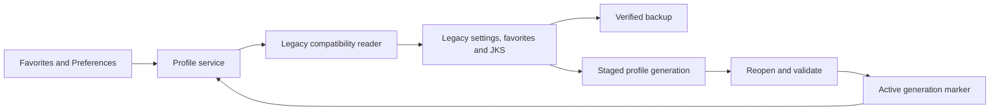
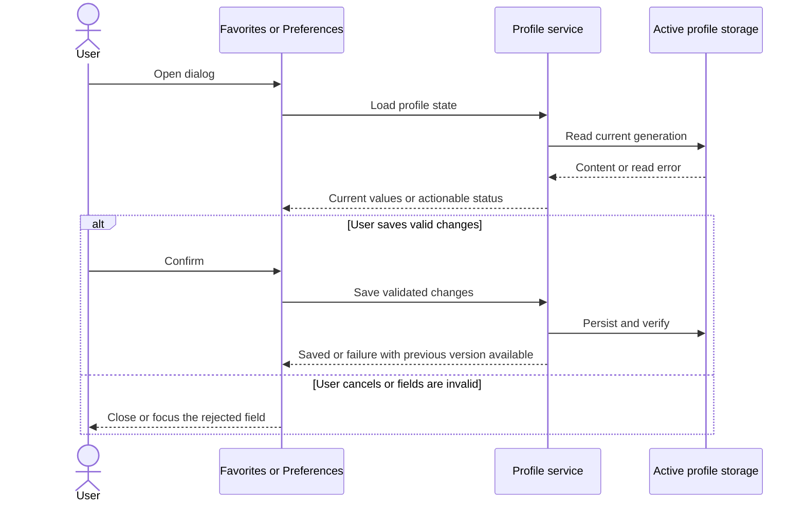
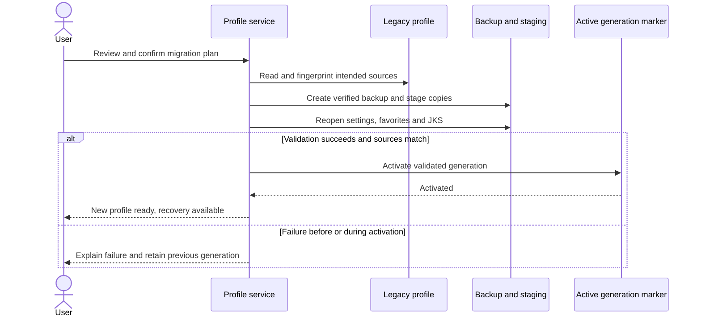

# ADR-002 — Profile compatibility and recoverable migration

**Date:** 2026-11-19  
**Status:** Accepted for legacy reads, backup, and recoverability. A new credential or certificate-exception policy is outside the first stage.  
**Relates to:** [Main architecture](000-main-architecture.md) · [FTP boundary](001-session-and-ftp-boundary.md) · [PRD](../PRD.md)

## 1. Scope

Keep Windows users' existing preferences, favorites, and client and server certificate stores readable. Prepare a migration that stages and validates a copy before switching the active profile. Characterize the legacy credential and certificate behavior so that future decisions start from evidence.

## 2. Technology Documentation References

| Technology | Official documentation | Used for |
| --- | --- | --- |
| Java file operations | [JDK 25 Files](https://docs.oracle.com/en/java/javase/25/docs/api/java.base/java/nio/file/Files.html) | Copy, validate, and activate in the same profile volume. |
| Java serialization | [JDK 25 ObjectInputFilter](https://docs.oracle.com/en/java/javase/25/docs/api/java.base/java/io/ObjectInputFilter.html) | Bound legacy compatibility reads according to the observed fixture types and sizes. |
| Java KeyStore | [JDK 25 KeyStore](https://docs.oracle.com/en/java/javase/25/docs/api/java.base/java/security/KeyStore.html) | Validate compatible JKS stores and preserve entries without converting formats. |

## 3. Component Design

The current desktop reads Java-serialized preferences and favorites under the user's `.jftp` directory. Preferences can point to server and client certificate stores outside that directory. The current favorites reader can write back an unencrypted legacy list after reading it. The migration reader therefore owns a read-only path for both forms and does not invoke the side-effecting legacy read against the source profile. Profile writes and activation pass through one profile service. [Preferences read and defaults](../../src/main/java/com/myjavaworld/jftp/JFTP.java#L535) · [Favorites reader](../../src/main/java/com/myjavaworld/jftp/FavoritesManager.java#L65) · [Certificate store defaults](../../src/main/java/com/myjavaworld/jftp/JFTPPreferences.java#L41)

The default migration target is a separate versioned generation in the same user profile directory. The first target generation retains the legacy formats so the team can qualify relocation and recovery independently of a format redesign. Copy certificate stores as bytes and preserve the mapping of server vs. client. Rebase references to default stores to the migrated copy. For custom external paths, copy only explicitly included files and report each retained external reference before approval. A committed-generation marker records which generation was successfully verified. One writer may migrate or save a profile at a time.

## 4. Data Structures

| Entity | Fields and relationship |
| --- | --- |
| Preferences | Locale and appearance, startup defaults, proxy and transfer options, update preference, and references and access settings for two certificate stores. |
| Saved site | Site name, host, ports, user/account, password if saved, directory and protocol options. A profile has zero or more saved sites. |
| Certificate stores | Server and client JKS files. Preserve aliases, entry types, and key/certificate access settings. Paths may be configured. |
| Migration record | Generation ID, source paths, planned destinations, input hashes, per-item outcome, and activation state. Diagnostic output excludes passwords, private keys, and decrypted site contents. |

In current code, favorites can be written as an AES-sealed serialized list using a key embedded in the application. A fallback writes the list unencrypted if the cipher is unavailable. This is legacy behavior to capture, and existing files and backups can contain credentials. In certificate verification, failed date, host, or trust checks can open a prompt. Decline rejects the connection, and Continue can reuse the accepted chain in the same checker instance. Explicitly managed trust-store entries have their own persistence path. This ADR introduces no new credential-storage or override policy. [Favorite write paths](../../src/main/java/com/myjavaworld/jftp/FavoritesManager.java#L112) · [Legacy cipher selection](../../src/main/java/com/myjavaworld/jftp/FavoritesManager.java#L170) · [Trust checks](../../src/main/java/com/myjavaworld/jftp/ssl/JFTPTrustManager.java#L76) · [JKS loading](../../src/main/java/com/myjavaworld/jftp/ssl/KeyStoreManager.java#L170)

## 5. Interface Contracts

| Operation | Input | Output and failure |
| --- | --- | --- |
| Inspect / load | Profile location and supported format | Typed values or an actionable read result. Distinguish missing, unreadable, malformed, and unsupported inputs. Inspecting an existing profile leaves original bytes intact. |
| Save | Active profile generation and validated changes | Persist the changes and report completion only after a successful write. Keep the prior complete version available on a write failure. |
| Plan migration | Source profile, target root, and selected external stores | List inputs, exact source and target paths, external references and conflicts. The user can cancel before activation. |
| Migrate | Reviewed plan, readable sources, available backup location, and exclusive write access | Back up first, stage copies, validate by reopening, then activate. If a source changes, required data cannot be read, or activation fails, keep the old generation active and report what needs attention. |
| Restore | Existing backup or previous committed generation | Validate and select the previous complete generation. Missing or incomplete backup produces a recovery error without altering the active profile. |

## 6. Technical Decisions

### Migrate through a distinct validated generation

**Status:** Accepted for the migration and recovery boundary  
**Date:** 2026-11-19  
**Context:** The existing favorite reader may rewrite a legacy file, and profile data includes separately located certificate stores. A migration can be interrupted after some files are copied.  
**Decision:** Verify recovery before activation. Store a byte-for-byte backup of all included sources, then stage and reopen the target files under a distinct generation. Switch the active generation through a single replace operation on the same volume, using an atomic move where supported. If the file system cannot provide the required activation semantics, stop before activation. Retain the source and previous ready generation. Re-running a completed migration with the same inputs reports the existing generation.  
**Rejected alternatives:** In-place conversion would make interruption and rollback harder to reason about. Coupling the first migration to a new credential format would make it harder to distinguish migration loss from format incompatibility.  
**Consequences:** Additional local disk space is required. Operators can compare pre- and post-migration data and restore a previous generation without reconstructing files.  
**Review trigger:** A qualified customer profile format cannot be read with the documented compatibility reader, or a new credential and certificate policy is approved.

## 7. Diagrams

### Components and data flow

### Open or save a profile

### Migration and recovery

## 8. Testing Strategy

| Scenario | Type | Input | Expected output and edge cases |
| --- | --- | --- | --- |
| Legacy preferences and favorites | Integration | Generated old profile with plaintext and sealed favorites fixtures | Load both forms, preserve non-ASCII names and settings, compare original file hashes before and after inspection. |
| Certificate stores | Integration | Generated server and client JKS files, custom path, wrong password | Existing aliases and entry types survive migration. Unreadable data prevents activation. |
| Interrupted migration and retry | Integration | Inject failure before backup completion, after staging, and before marker replacement | Old generation remains active after each failure. A valid retry activates exactly one generation. |
| Save and reuse | Windows UI | Isolated profile, edited valid settings, invalid field, saved site | Successful preferences save confirms, invalid input stays visible, and an existing favorite can connect to the controlled server after reopening. |
| Legacy certificate handling | Windows UI and integration | Local FTPS endpoint and generated untrusted or mismatched certificate | Record warning reasons, decline path, and current Continue behavior. Test fixtures contain synthetic keys and passwords. |

### Technical acceptance criteria

- **TAC-002-01** Supported fixture formats reopen with matching preferences, site settings and certificate aliases after migration.
- **TAC-002-02** The backup and source hashes match for every included input. Cancelling or failing before activation leaves the original hashes and active generation unchanged.
- **TAC-002-03** After a successful migration, repeating the same request reuses the committed generation. Restoring the previous generation returns the pre-migration settings.
- **TAC-002-04** Corrupt input or wrong store password reports a failure associated with the affected file and prevents activation.
- **TAC-002-05** Migration and test reports contain no fixture password, decrypted favorite content, or private key material.
