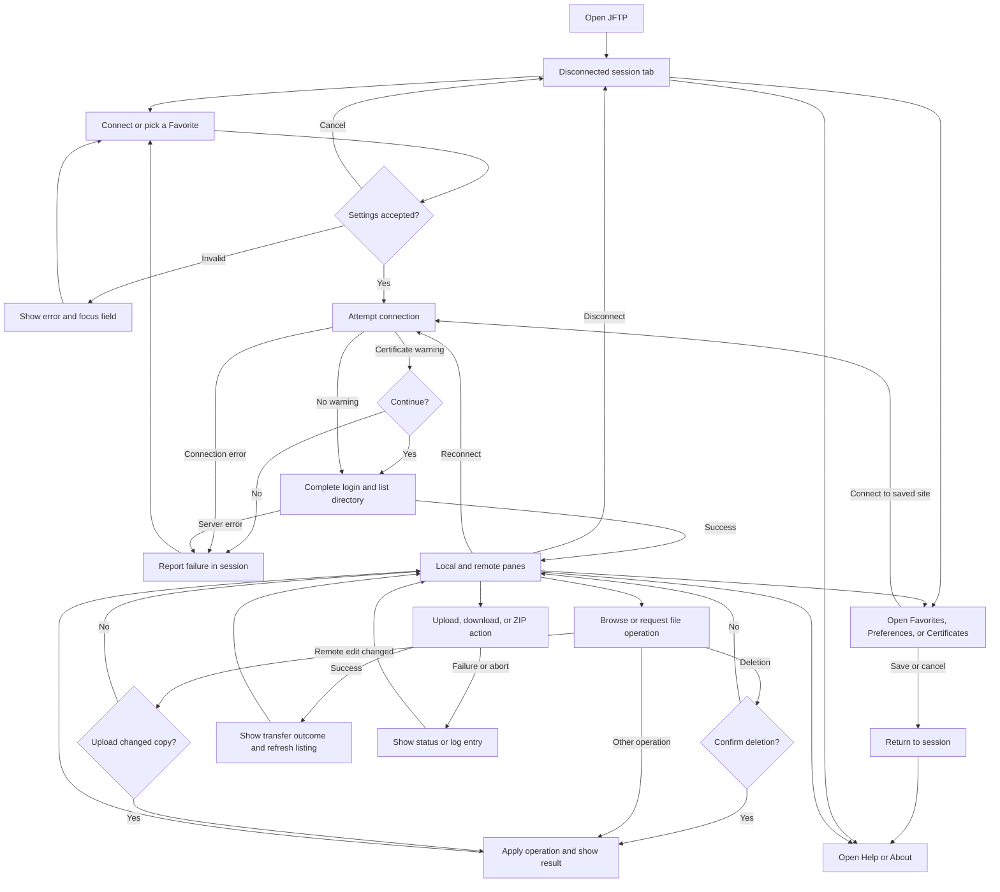

# PRD — JFTP Desktop

## 1. Executive Summary

JFTP is an existing desktop FTP and FTPS client for users who browse, manage, and move files between their computer and a remote FTP server. This document gives the team taking over and modernizing JFTP a baseline for its current user-facing behavior, including connection settings, transfers, saved sites, certificate decisions, and help. It is based on source inspection at revision `a15ac14`.

## 2. Problem Statement

Users who maintain remote files need to see both sides of a transfer, select the correct destination, and tell whether a connection or operation succeeded. Repeat work adds the burden of re-entering connection settings, and secure or proxied environments can require a certificate decision or additional settings. Without a shared view of those states, users must track the local directory, remote directory, connection details, and transfer outcomes separately.

## 3. Users / Personas

The personas are inferred from the available workflows. The primary reader of this PRD is the team taking over JFTP.

| Persona | Goal | Expected outcome |
| --- | --- | --- |
| File transfer operator | Publish, retrieve, or organize files across one or more FTP servers | See which session and directory are active and whether selected files reached the intended destination |
| Repeat site operator | Return to known servers with site-specific login, directory, and transfer settings | Pick a saved site and connect with its saved details |
| Operator in a managed environment | Use a proxy or a secured FTP server and inspect certificate warnings | See what needs attention and decide whether to continue the connection |

## 4. Main Flows

### 4.1 Open a session and connect [E1, E2, E3]

1. JFTP opens a session tab in the disconnected state. The local file pane remains available. The user can create another tab and switch between sessions.
2. The user opens **Connect**, enters host, port, username, password, and an account if needed. The user can set security mode, active or passive transfers, initial folders, and commands to run after login.
3. On invalid input, JFTP shows an error, selects the relevant tab, and moves focus to the affected field. Cancelling the dialog returns to the session without submitting a connection.
4. JFTP shows connection activity. A secure connection can display a certificate warning requiring a user decision. Declining stops that connection attempt.
5. After a successful login and directory listing, the remote pane displays the working directory and its entries. JFTP reports server and connection errors in the session log. A user can disconnect, reconnect with the most recent site settings for the tab, or close the tab.

### 4.2 Browse and manage files [E1, E4]

1. The user navigates the local or remote directory with the corresponding pane. JFTP displays entries with their file information and allows the user to sort or filter the list.
2. The user selects a file action such as create, rename, delete, or view properties. The remote pane requires a connection for remote actions. Open, edit, or print operations use the desktop environment's handling of the selected file where available.
3. JFTP requests confirmation before deleting selected entries. Cancelling leaves the entries untouched. A failed operation is reported through an error dialog or the session log, depending on the operation.
4. The user can inspect or change supported remote permissions and submit a manual FTP command in a connected session. The server determines whether a requested remote operation is permitted.
5. When JFTP detects a change to a copy opened for remote editing, it asks whether to upload the changed copy back to the remote file. Declining leaves the remote file untouched by that edit.

### 4.3 Transfer files or work with ZIP archives [E4, E5]

1. In a connected session, the user selects entries from the source pane and chooses Download or Upload, or drags them to the opposite pane. JFTP transfers them toward the destination pane's current directory. Ordinary folder transfers traverse their contents, subject to the applicable file filter.
2. The user can choose a different name for a selected item through Download As or Upload As, choose Zip and Upload for selected local items, or choose Download and Unzip for a selected remote ZIP file. ZIP dialogs let the user choose local destinations for the archive or extracted files as applicable.
3. JFTP shows transfer status and refreshes the destination pane after a standard transfer. The user can request Abort during a transfer. A transfer may stop after some items have already been processed, so the resulting files and session log show the observed outcome.

### 4.4 Save and reuse connection settings [E2, E6]

1. The user opens Favorites, adds or edits a named site, and saves it. The site can carry its own credentials and connection options.
2. The user selects a saved site and chooses Connect. JFTP uses the active session or creates one if required. Removing a saved site requires confirmation.
3. The user opens Preferences to set defaults for connections, proxy, security, transfer modes, locale, appearance, or update checks. JFTP reports invalid fields before saving and confirms successful persistence or reports a save error.

### 4.5 Manage certificates and get help [E3, E7]

1. The user opens **Manage Certificates** to view certificate details or add or remove certificates. The available actions depend on the selected certificate category and entry.
2. During a secured connection, the user can inspect the certificate chain in a warning dialog and choose whether to continue. The warning can reflect an invalid date, a hostname mismatch, or lack of trust.
3. The user opens Help for contents, tips, FAQs, support, feedback, or product information. Dialogs with contextual help open the relevant topic. When update checks are enabled, opening the main window can trigger a check and an available update can produce a notification.

## 5. User Stories

- As a transfer operator, I want to connect and see the remote directory alongside my local directory, so that I can choose the correct source and destination.
- As a transfer operator, I want to see why a connection failed, so that I can correct the input or check the server before retrying.
- As a repeat site operator, I want to save and reuse site settings, so that I can reconnect without entering them again.
- As an operator working with several servers, I want separate session tabs, so that I can switch servers while retaining the context of each session.
- As an operator using FTPS, I want to inspect an unexpected certificate and decline the connection, so that I can decide whether to proceed.
- As a file operator, I want deletion confirmation and a way to abort an active transfer, so that I can stop an operation when I find a mistake.

## 6. Acceptance Criteria

These criteria describe observable behavior supported by the inspected source.

### Sessions and connections

- **AC-01** Opening the desktop client creates one selected session tab labeled disconnected in the active language. [E1]
- **AC-02** Choosing New Session adds a disconnected tab and selects it. [E1]
- **AC-03** Cancelling the Connect dialog initiates no connection attempt. [E2]
- **AC-04** Submitting an empty host, username, or password displays an error and focuses the rejected field. [E2]
- **AC-05** Submitting a main port outside the range 0–65535 is rejected by the Connect form. [E2]
- **AC-06** After login and a successful directory listing, the remote pane displays the resulting working directory and entries. [E2]
- **AC-07** Choosing Reconnect in a session with prior site settings uses those settings for the connection attempt. [E2]
- **AC-08** If the user declines a certificate warning, JFTP stops the secure connection attempt. [E3]

### File operations and transfers

- **AC-09** Opening the local file filter dialog offers filename pattern, date, and hidden-file options. [E4]
- **AC-10** Cancelling a confirmation for deletion leaves the selected entries in place. [E4]
- **AC-11** In a connected session, a successful ordinary Download places the selected remote file in the current local directory and refreshes the local listing. [E5]
- **AC-12** In a connected session, a successful ordinary Upload places the selected local file in the current remote directory and refreshes the remote listing. [E5]
- **AC-13** Download As accepts a destination name for the selected remote item. [E5]
- **AC-14** Zip and Upload creates a ZIP from the selected local items and uploads it under the chosen name when both operations succeed. [E5]
- **AC-15** Download and Unzip extracts the selected remote ZIP into the chosen local extraction directory when download and extraction succeed. [E5]
- **AC-16** When the FTP client reports a user-aborted transfer, JFTP adds an abort entry to the session log. [E5]

### Favorites, preferences, and help

- **AC-17** Choosing Connect on a selected saved site attempts a connection using that site's settings. [E6]
- **AC-18** Successful Preferences save displays a confirmation. [E6]
- **AC-19** Choosing Contents and Index from the Help menu opens the mapped contents topic. [E7]
- **AC-20** The transfer mode menu offers Auto Detect, ASCII, and Binary. [E5]
- **AC-21** The certificate manager can display details for a selected certificate. [E3]

### Direct file interaction

- **AC-22** Dropping a selection from the local pane onto the remote pane invokes Upload for the current session. [E5]
- **AC-23** When JFTP detects a change to a copy opened through remote Edit, it asks whether to upload the changed copy. [E4]

## 7. Out of Scope

- **Other clients** — web, mobile, and any legacy applet entry point.
- **Modernization design** — proposed screens, new protocols, migration decisions, and changes to existing behavior.
- **Distribution and operations** — build instructions, installation procedures, operating system certification, and server administration.
- **Third-party internals** — protocol negotiation implementation, server interoperability guarantees, and behavior of desktop programs used to open or print files.
- **Organization policies** — usage volumes, compliance requirements, and deployment restrictions that were not supplied.

## 8. Constraints

### Business

- Remote actions operate under the FTP server account and depend on the server's permissions.
- Favorites and preferences are saved by the desktop client and can be reused in later sessions. The application reports a persistence failure when it surfaces through the corresponding save flow.

### Functional

- Connection modes offered by the UI are plain FTP, SSL if available, explicit SSL, and implicit SSL. The implicit SSL port has its own form validation. These option names describe the UI and do not establish compatibility with a particular server.
- The Connect form requires nonblank host, username, and password and accepts integer port values from 0 to 65535. The ordinary connection port is validated even when implicit SSL is selected.
- File transfer can use active or passive mode. Preferences expose proxy settings, including SOCKS and optional proxy authentication.
- ZIP is the archive format exposed by the archive actions. Transfer mode choices are ASCII, Binary, and Auto Detect.
- Bundled interface translations include English, German, and Traditional Chinese. The locale preference offers more choices than the bundled translations.

## 9. UI Description

### Main window and session tab [E1, E4, E5]

The window has a menu bar and toolbar above the session tabs. The selected tab displays the session log above two file panes, with local on the left and remote on the right. A status area at the bottom shows activity and progress. A disconnected tab has no live remote listing. The selection and connection state determine the remote actions available. A connection or transfer can show a busy state, and the user can inspect failure details in the log. File operations and transfers are available from menus and toolbar controls where applicable.

### Connect [E2, E3]

The dialog provides login fields and tabs for security, advanced options, and commands. **Connect** submits the settings, **Cancel** closes the dialog, and **Help** opens the associated topic. Input validation keeps the dialog open and directs the user to the rejected field. Once submitted, activity and server errors appear in the session.

### File filters, properties, and operation dialogs [E4, E5]

The local and remote panes offer dialogs for filtering, changing directory, creating or renaming entries, and inspecting properties. Filter dialogs accept patterns and date constraints. The local filter also has a hidden-file option. Delete opens confirmation, while name and destination dialogs allow the user to confirm or cancel the operation. ZIP dialogs offer local working, alternate, or temporary locations where applicable. Transfer activity is shown in the session.

### Favorites and Preferences [E6]

Favorites presents a site list and controls to add, edit, remove, or connect. Connecting and editing depend on selection. Preferences uses a category tree with a settings panel for the chosen category. Confirming validates and saves the settings. Invalid fields return the user to the affected category, and persistence errors are shown to the user.

### Certificate manager and security warning [E3]

The manager has categories for server and client certificates, entry lists, and controls to view, import, or remove entries where applicable. The warning dialog identifies the failed checks, offers certificate details, and asks whether to continue the secure connection. Closing or declining that warning rejects the attempt.

### Help and update notice [E7]

The Help menu and help buttons open mapped topics. About displays product information. A separate notice can report an available update when the configured check returns one.

## 10. User Flow Diagram

## 12. Further Notes

- This baseline was derived from source and bundled help. The application, real servers, proxies, and current update endpoint were not exercised. No claims are made about maximum transfer size, maximum sessions, current server compatibility, or distribution behavior.
- The source allows the user to proceed past some certificate warnings and can reuse that decision for the same presented chain within the connection's certificate checker. The scope of that decision is distinct from explicitly managing certificates. [E3]
- The connection completion path attempts to apply the configured initial local directory after clearing the busy state, including when the connection is unsuccessful. The exact state following a failed listing or interrupted transfer should be confirmed on the running client. [E2, E5]
- The archive download flow invokes extraction after the download helper returns. The observable outcome when an archive download fails partway is open. [E5]

### Source evidence

| ID | Behavior used in this PRD | Sources |
| --- | --- | --- |
| E1 | Startup, disconnected tab, and session layout | [Desktop entry](../src/main/java/com/myjavaworld/jftp/JFTPApplication.java#L55) · [Tab lifecycle](../src/main/java/com/myjavaworld/jftp/JFTP.java#L148) · [Session layout](../src/main/java/com/myjavaworld/jftp/FTPSession.java#L288) |
| E2 | Connect input, submission, connection outcomes, reconnection, and proxy preferences | [Connect form](../src/main/java/com/myjavaworld/jftp/ConnectionDlg.java#L116) · [Validation](../src/main/java/com/myjavaworld/jftp/ConnectionDlg.java#L673) · [Connect action](../src/main/java/com/myjavaworld/jftp/actions/ConnectAction.java#L51) · [Connect and reconnect](../src/main/java/com/myjavaworld/jftp/FTPSession.java#L593) · [Proxy preferences](../src/main/java/com/myjavaworld/jftp/ProxyPrefsPanel.java#L218) |
| E3 | Certificate decisions and manager actions | [Certificate checks](../src/main/java/com/myjavaworld/jftp/ssl/JFTPTrustManager.java#L77) · [Warning dialog](../src/main/java/com/myjavaworld/jftp/ssl/SecurityWarningDlg.java#L104) · [Certificate manager](../src/main/java/com/myjavaworld/jftp/ssl/CertificateManagerDlg.java#L180) |
| E4 | Pane and file operations, permissions, filtering, and manual commands | [Local menu](../src/main/java/com/myjavaworld/jftp/LocalSystemMenu.java#L277) · [Remote menu](../src/main/java/com/myjavaworld/jftp/RemoteSystemMenu.java#L292) · [Local filter](../src/main/java/com/myjavaworld/jftp/LocalFileFilterDlg.java#L150) · [Remote filter](../src/main/java/com/myjavaworld/jftp/RemoteFileFilterDlg.java#L146) · [Permissions and file operations](../src/main/java/com/myjavaworld/jftp/FTPSession.java#L1074) · [Remote edit confirmation](../src/main/java/com/myjavaworld/jftp/FTPSession.java#L153) · [Commands](../src/main/java/com/myjavaworld/jftp/FTPSession.java#L1420) |
| E5 | Transfer outcomes, names, ZIP, mode selection, abort | [Download and upload](../src/main/java/com/myjavaworld/jftp/FTPSession.java#L707) · [Download As](../src/main/java/com/myjavaworld/jftp/actions/DownloadAsAction.java#L53) · [Upload As](../src/main/java/com/myjavaworld/jftp/actions/UploadAsAction.java#L53) · [ZIP upload](../src/main/java/com/myjavaworld/jftp/actions/ZipAndUploadAction.java#L59) · [ZIP download](../src/main/java/com/myjavaworld/jftp/actions/DownloadAndUnzipAction.java#L59) · [Transfer modes](../src/main/java/com/myjavaworld/jftp/TransferModeMenu.java#L57) · [Abort status](../src/main/java/com/myjavaworld/jftp/FTPSession.java#L560) · [Drag and drop](../src/main/java/com/myjavaworld/jftp/DnDTransferHandler.java#L89) |
| E6 | Favorites, preferences, and locale | [Favorites actions](../src/main/java/com/myjavaworld/jftp/FavoritesDlg.java#L95) · [Favorite connection](../src/main/java/com/myjavaworld/jftp/FavoritesDlg.java#L232) · [Preferences validation and save](../src/main/java/com/myjavaworld/jftp/PreferencesDlg.java#L287) · [Locale options](../src/main/java/com/myjavaworld/jftp/LocalePrefsPanel.java#L108) · [Bundled language resources](jftp-runtime-resources.md) |
| E7 | Help topics and update notice | [Help menu](../src/main/java/com/myjavaworld/jftp/HelpMenu.java#L60) · [Topic mapping](../src/main/help/helpset/map.xml#L13) · [Update check at window opening](../src/main/java/com/myjavaworld/jftp/JFTP.java#L155) · [Update notice](../src/main/java/com/myjavaworld/jftp/AutoUpdater.java#L62) |
