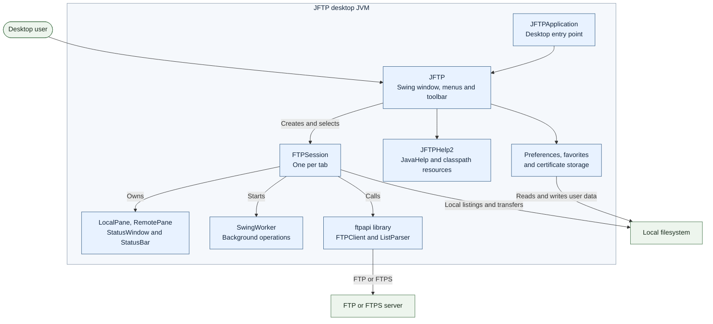
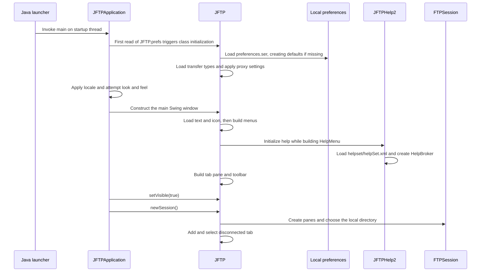
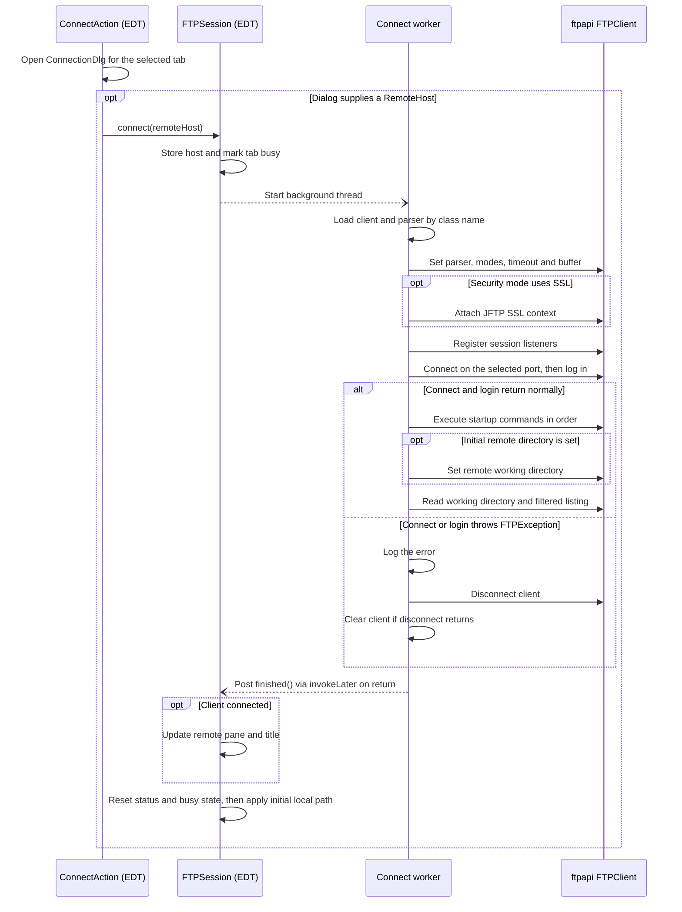
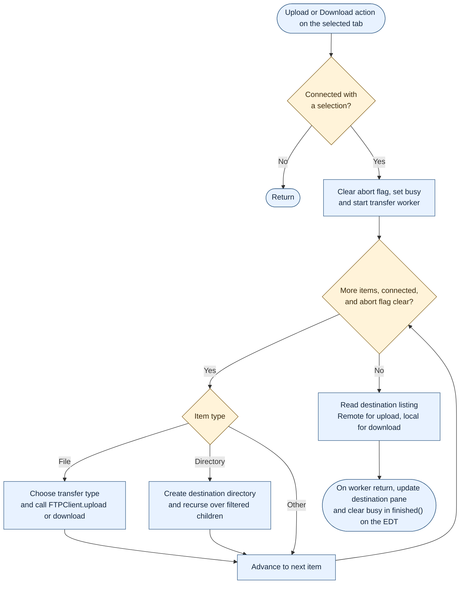
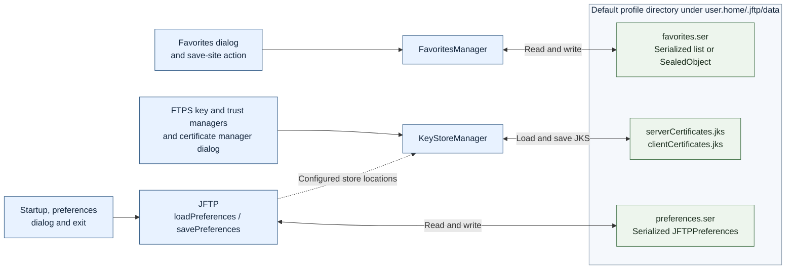

# JFTP desktop architecture

These diagrams describe the desktop application at revision `2351f40f2e17b47bb6317820f1eaac828809cd4c`. The source review covers the Maven build, desktop entry point, Swing tabs, primary FTP workflows, and local profile files. The [modernization ADR](ADR/000-main-architecture.md) describes the target architecture.

## Components and external boundaries

JFTP runs as one Swing application in a JVM. Each tab is an `FTPSession` that owns its panes, working directories, filters, and FTP client reference. The session starts workers for blocking operations and calls the in-process `ftpapi` library directly. The diagram groups profile code by responsibility and focuses on FTP operations. The update check, archive actions, and platform-specific integration are outside this view.

[Mermaid source](diagrams/components.mmd) · [SVG](diagrams/components.svg)



- `new FTPSession(this)` and `tabs.addTab(title, session)` establish tab ownership. Each session creates the local pane, remote pane, status window, and status bar. [Window](../src/main/java/com/myjavaworld/jftp/JFTP.java#L123-L153) · [Session fields](../src/main/java/com/myjavaworld/jftp/FTPSession.java#L70-L108) · [Pane construction](../src/main/java/com/myjavaworld/jftp/FTPSession.java#L289-L313)
- `client.connect(...)`, `client.download(source, target, ...)`, and `client.upload(source.getFile(), destination, ...)` establish the boundary with the FTP server and local files. Maven declares `ftpapi:3.0.0` and JavaHelp. [Connect](../src/main/java/com/myjavaworld/jftp/FTPSession.java#L624-L652) · [Download](../src/main/java/com/myjavaworld/jftp/FTPSession.java#L812-L832) · [Upload](../src/main/java/com/myjavaworld/jftp/FTPSession.java#L897-L921) · [Dependencies](../pom.xml#L71-L80)

## Desktop startup

This sequence starts at the JAR's configured entry point and follows successful initialization. The constructor runs directly from `main`. The first preference read initializes `JFTP`, and the window is shown before the first disconnected tab is added.

[Mermaid source](diagrams/desktop-startup.mmd) · [SVG](diagrams/desktop-startup.svg)



- The manifest names `JFTPApplication`. The initial `Locale.setDefault(JFTP.prefs.getLocale())` follows the static preference load and proxy setup. The constructor calls `setVisible(true)` before `newSession()`. [Manifest](../pom.xml#L113-L125) · [Entry point and constructor](../src/main/java/com/myjavaworld/jftp/JFTPApplication.java#L28-L67) · [Static initialization](../src/main/java/com/myjavaworld/jftp/JFTP.java#L76-L110)
- Building the menu calls `JFTPHelp2.getInstance().enableHelp(...)`. The help class calls `HelpSet.findHelpSet(...)` and `createHelpBroker(...)`. The first tab takes its local path from preferences, falling back to the platform's default directory when that path is unavailable. [Window menus](../src/main/java/com/myjavaworld/jftp/JFTP.java#L458-L473) · [Help menu](../src/main/java/com/myjavaworld/jftp/HelpMenu.java#L53-L89) · [JavaHelp initialization](../src/main/java/com/myjavaworld/jftp/JFTPHelp2.java#L32-L51) · [Local directory](../src/main/java/com/myjavaworld/jftp/FTPSession.java#L125-L135)

The assembly puts the application JAR at the package root and dependencies in `lib/`. The historical launchers looked for the JAR under `lib/`. The repaired Windows launcher resolves the root JAR relative to the batch file. [Assembly](../src/main/assembly/binary.xml) · [Windows launcher](../src/main/scripts/jftp.bat) · [Packaged resource index](jftp-runtime-resources.md)

## Connect a disconnected tab

The sequence follows the Connect dialog into the selected tab. EDT is Swing's event dispatch thread. The worker initializes the client and parser by reflection, then performs the network calls. The diagram shows the normal path and the specific `FTPException` branch around connect and login.

[Mermaid source](diagrams/connect-session.mmd) · [SVG](diagrams/connect-session.svg)



- `session.connect(remoteHost)` runs when the dialog supplies a host. The worker uses `Class.forName(...)`, registers the session as a listener, then calls `client.connect(...)` and `client.login(...)`. Implicit SSL uses the separate implicit SSL port. [Connect action](../src/main/java/com/myjavaworld/jftp/actions/ConnectAction.java#L51-L75) · [Worker setup and login](../src/main/java/com/myjavaworld/jftp/FTPSession.java#L607-L658)
- After login, the worker runs startup commands and reads the filtered listing. `finished()` updates the remote pane and title only if the client reports connected. It then clears the busy state and applies the initial local path if that path is valid. `SwingUtilities.invokeLater(doFinished)` runs after the worker returns. An exception escaping `construct()` in this worker abstraction can bypass that post. [Post-login and completion](../src/main/java/com/myjavaworld/jftp/FTPSession.java#L659-L698) · [Local path handling](../src/main/java/com/myjavaworld/jftp/FTPSession.java#L338-L366) · [Worker implementation](../src/main/java/com/myjavaworld/gui/SwingWorker.java#L124-L157)

For an already-connected tab, the confirmation precedes `disconnect()`. That method starts a separate worker, and the connect path proceeds without waiting for it to finish. Other caught connection and setup errors go through the session's error handlers. The listener registration is visible in JFTP, while the FTP library's dispatch threads and wire behavior would require inspecting the dependency or observing it at runtime. [Reconnect check](../src/main/java/com/myjavaworld/jftp/FTPSession.java#L593-L607) · [Disconnect worker](../src/main/java/com/myjavaworld/jftp/FTPSession.java#L1495-L1530) · [Error handlers](../src/main/java/com/myjavaworld/jftp/FTPSession.java#L571-L590)

## Upload and download

This activity covers the standard actions for selected files and directories. One worker iterates over the selection and recurses into filtered directory children. A batch that reaches the end of its loop attempts to refresh the destination listing, even if the loop stopped on abort or lost connection. Rename-on-transfer, ZIP, and drag-and-drop are outside this view.

[Mermaid source](diagrams/file-transfer.mmd) · [SVG](diagrams/file-transfer.svg)



- The actions call `session.upload()` or `session.download()`. Each worker checks `!client.isConnected() || abort` before the next selection, then refreshes the destination pane in `finished()` if the worker returns. Download lists the local directory and upload attempts a remote list. [Upload action](../src/main/java/com/myjavaworld/jftp/actions/UploadAction.java#L50-L57) · [Download action](../src/main/java/com/myjavaworld/jftp/actions/DownloadAction.java#L49-L55) · [Upload worker](../src/main/java/com/myjavaworld/jftp/FTPSession.java#L835-L876) · [Download worker](../src/main/java/com/myjavaworld/jftp/FTPSession.java#L707-L738)
- Recursive calls recheck the connection and abort flag and skip directory entries named `.` and `..`. Download uses `client.list(remoteFileFilter)` for children and upload uses `source.list(localFileFilter)`. Abort calls `session.setAbortFlag(true)` and starts a separate worker to invoke `client.abort()`. The effect on in-flight I/O and partial files depends on the external library. [Download recursion and file transfer](../src/main/java/com/myjavaworld/jftp/FTPSession.java#L745-L832) · [Upload recursion and file transfer](../src/main/java/com/myjavaworld/jftp/FTPSession.java#L884-L941) · [Abort action](../src/main/java/com/myjavaworld/jftp/actions/AbortAction.java#L53-L79)

## Local profile storage

`user.home/.jftp/data` is the profile directory used for preferences and favorites. The certificate paths shown are defaults. `KeyStoreManager` obtains the actual paths from preferences.

[Mermaid source](diagrams/profile-storage.mmd) · [SVG](diagrams/profile-storage.svg)



- `new File(DATA_HOME, "preferences.ser")` is read and written with Java object streams. `FavoritesManager` opens `favorites.ser`, reads either a list or a `SealedObject`, and writes a sealed list when it can obtain a cipher. [Profile directory](../src/main/java/com/myjavaworld/jftp/JFTP.java#L64-L74) · [Preference streams](../src/main/java/com/myjavaworld/jftp/JFTP.java#L512-L565) · [Preferences dialog](../src/main/java/com/myjavaworld/jftp/PreferencesDlg.java#L311-L333) · [Exit](../src/main/java/com/myjavaworld/jftp/JFTP.java#L199-L215) · [Favorites UI](../src/main/java/com/myjavaworld/jftp/FavoritesDlg.java#L325-L342) · [Save site](../src/main/java/com/myjavaworld/jftp/JFTP.java#L437-L445) · [Favorites streams](../src/main/java/com/myjavaworld/jftp/FavoritesManager.java#L45-L130)
- The FTPS context constructs `JFTPKeyManager` and `JFTPTrustManager`, which request the client and server stores respectively. `KeyStoreManager` uses `KeyStore.getInstance("JKS")` and loads or saves at the configured locations. [SSL context](../src/main/java/com/myjavaworld/jftp/ssl/JFTPSSLContext.java#L35-L45) · [Client key manager](../src/main/java/com/myjavaworld/jftp/ssl/JFTPKeyManager.java#L38-L49) · [Server trust manager](../src/main/java/com/myjavaworld/jftp/ssl/JFTPTrustManager.java#L57-L65) · [Certificate dialog](../src/main/java/com/myjavaworld/jftp/ssl/CertificateManagerDlg.java#L230-L272) · [Default store paths](../src/main/java/com/myjavaworld/jftp/JFTPPreferences.java#L38-L44) · [Store I/O](../src/main/java/com/myjavaworld/jftp/ssl/KeyStoreManager.java#L164-L225)

## Verification

The diagram edges are based on the linked source at the revision above. The [repository map](repo-maps/repo-map.rust.md) and the connection section of the [full Repomix package](repomix/jftp.xml) were used for navigation. The startup ordering and entry-thread boundary follow from the direct calls in `main` and its constructor. FTP library internals, packaged startup, and live application behavior remain unverified.

All five sources parsed and rendered locally with Mermaid CLI 11.12.0, Mermaid 11.17.2, and headless Chrome 157.0.8103.80. The SVG previews were inspected in Chrome. The Markdown fences match the standalone sources after newline normalization.

The CLI input was a temporary Markdown batch containing the five standalone sources as Mermaid fences, in the order shown here. The Chromium config selected the installed Chrome executable and an isolated profile.

```sh
mmdc --version
mmdc --help
mmdc -i batch.md -o preview.md -p chromium.json -b white
```

| Diagram | Mermaid SHA-256 (LF) | SVG SHA-256 |
| --- | --- | --- |
| components | `3c45b8ac4fce01be51c5081d14efc1860b49395030db89193bbc81dee5601c1e` | `14b539c58eb00f23ce24b2f2631288948f897223bfea7793c6f1f2a9a7b49c3b` |
| desktop-startup | `382a9e0f579e08bf983fa1dcda03bb9b27c44bc960bfb2da67aa29b9d7a08ede` | `a9fa16f77205a818fbfcdae1821c488e011da118da1779fc5d30663dc2ef4978` |
| connect-session | `ade8c7d3364ed8e44d3cd79d19ad3453f19de405a015814011ff73505eb55d6d` | `3146606aef6bc7d4a839db612b2820ca9b80be801e55ca98ee04fcc381930af9` |
| file-transfer | `16870d450573c32fb3adb7868ffc4a4923f6b2da714c141c30236be927720f33` | `e3cf5f59d40fce34c9d3f4e01c3b35abf22b27d11beb2931454b2486cb79b28a` |
| profile-storage | `0707ce361e5beaf74c77228d3e3b65d11baee7a0342db0d901da99fb48ea9a68` | `d38cde05534b2d2058b94cffe3bccacb925c2382d6d3750a0d460fe68658d3b0` |
